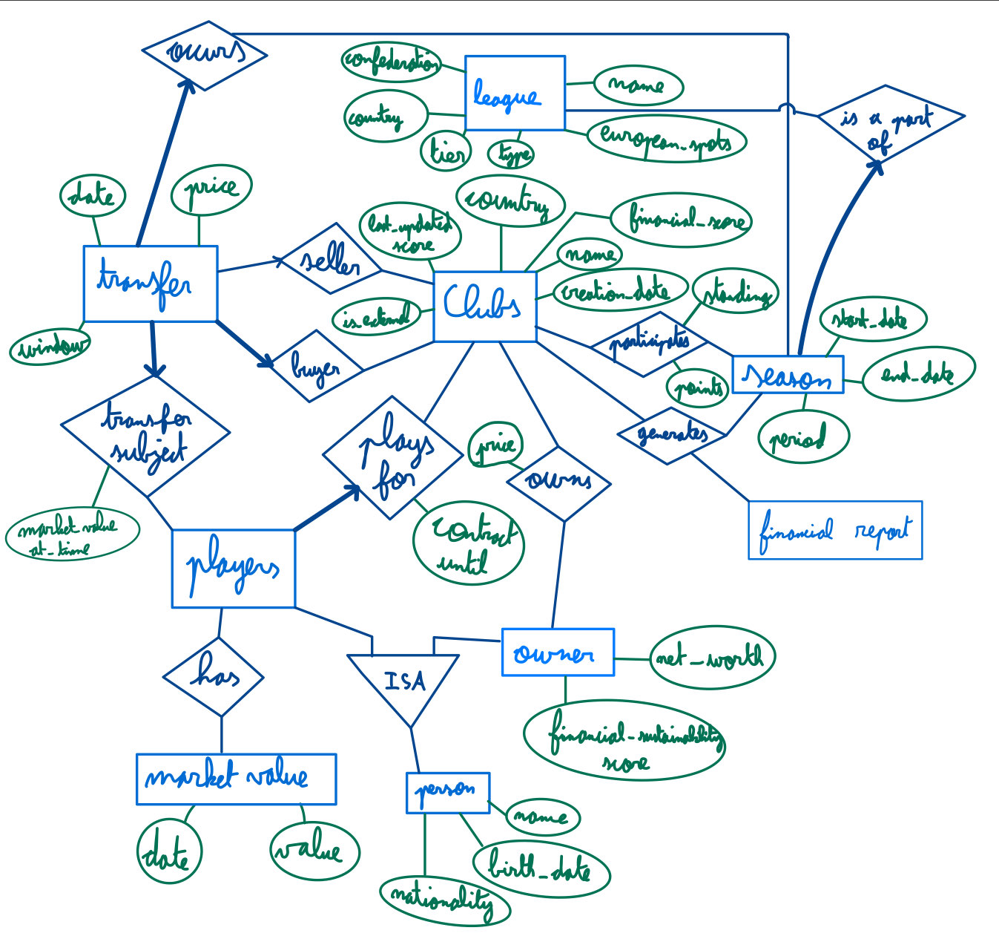

# Plus-Value — Backend

The Express API backend for **Plus-Value**, a Ligue 1 club finance and transfer intelligence web app.

Built with Node.js and Express 5.

## Getting Started

### Prerequisites

- Node.js 18+ (required for the built-in `fetch` API)

### Install Dependencies

```bash
cd backend
npm install
```

### Environment Variables

Create a `.env` file in the `backend/` directory:

```bash
cp .env.example .env
```

Then fill in the required values:

| Variable | Required | Description |
|---|---|---|
| `MONGODB_URI` | **Yes** | MongoDB Atlas connection string (e.g. `mongodb+srv://<user>:<password>@<cluster>.mongodb.net/<db>`) |
| `CUSTOM_DATA_URL` | No | Override the default Transfermarkt DuckDB download URL |
| `CUSTOM_DATA_DIR` | No | Override the default `data/` directory for the DuckDB snapshot |

### Development Server

```bash
npm run dev
```

Runs with nodemon, so the server restarts automatically on file changes.

For production:

```bash
npm start
```

The server runs on `http://localhost:3000` by default (check `src/server.js` for the exact port).

## Jobs

### Download Market Dataset

**Script:** `src/jobs/marketDataset.js`

Downloads the public [transfermarkt-datasets](https://github.com/dcaribou/transfermarkt-datasets) DuckDB snapshot into `data/market-datasets.duckdb`.

```bash
node src/jobs/marketDataset.js
```

You can override the download URL or output directory with the `CUSTOM_DATA_URL` and `CUSTOM_DATA_DIR` env vars (see table above).

#### Inspecting the DuckDB file

1. Install the [DuckDB CLI](https://duckdb.org/docs/installation/).
   - On Windows: put the executable under **Program Files** and add that folder to your **PATH**.
2. Open a terminal in the `data/` directory and run:

```bash
duckdb market-datasets.duckdb
```

3. Try a query:

```sql
SELECT * FROM clubs WHERE name ILIKE '%lyon%';
```

Full documentation: [DuckDB docs](https://duckdb.org/docs/).

### Sync Leagues to MongoDB

**Script:** `src/jobs/mongo/leagueSync.js`

Reads the `competitions` table from the local DuckDB snapshot and upserts rows into the MongoDB `leagues` collection. Existing documents are matched on `competitionId`; the sync updates `name`, `confederation`, `competitionFormat`, and `tier` (when derivable), and `country` when the source has one, while **not** overwriting `europeanSpots` so manual values in MongoDB are preserved.

**Prerequisites:** `MONGODB_URI` in `.env`, and the DuckDB snapshot present (see [Download Market Dataset](#download-market-dataset) above). Rows that are missing any required field (`competitionId`, `name`, or `confederation` after mapping from DuckDB) are skipped and counted in the summary; they are not written to MongoDB. `country` is optional (many international competitions have no host country in the source data).

**Default run (summary only):**

```bash
node src/jobs/mongo/leagueSync.js
```

Prints a single line of counts, for example: how many competition rows were read, how many were skipped, how many were synced, and MongoDB `upserted` / `modified` counts from the bulk write.

**Verbose (per skipped row):** Use this when you want to see *which* competitions were skipped and *which* fields were empty.

- **Flags:** `node src/jobs/mongo/leagueSync.js --verbose` or `-v`
- **Environment:** set `LEAGUE_SYNC_VERBOSE=1` (or `true` / `yes`) in `.env` so every run of the script is verbose without passing a flag

With verbose on, the script still prints the same summary line, then a short list: each skipped row shows a stable id/name when available and the list of required fields that were missing (mapped to the League schema: `competitionId`, `name`, `confederation`).

## API

All endpoints live under `/api`, are read-only (`GET`) and return JSON. Ids are MongoDB ids, dates are ISO strings and amounts are in euros. Errors come back as `{ "error": "<message>" }`: 400 for an invalid id or query parameter, 404 for an unknown resource and 500 for anything unexpected (the message is then generic).

Current market values follow one rule everywhere: a player's latest valuation counts only if it is no older than one market window (12 months) before the newest valuation in the database; otherwise it is `null`.

### Health

`GET /api/health`

```json
{ "status": "ok", "database": "connected" }
```

### Pickers

`GET /api/leagues` lists the leagues that have synced seasons, Ligue 1 first.

```json
{ "leagues": [{ "id": "FR1", "name": "Ligue 1", "country": "France", "tier": 1 }] }
```

`GET /api/clubs?league=FR1` lists clubs by name. Without `league`, it returns the clubs of the synced league; with it, the clubs that played a season in that league.

```json
{ "clubs": [{ "id": "65f0…", "name": "Olympique Lyonnais", "country": "France" }] }
```

`GET /api/seasons?league=FR1` lists seasons, newest first.

```json
{ "seasons": [{ "id": "65f1…", "period": "2025/2026", "startDate": "2025-08-15T00:00:00.000Z", "endDate": "2026-05-16T00:00:00.000Z", "league": "FR1" }] }
```

### Players (KF-1)

`GET /api/players?q=laca&club=<clubId>&limit=20` searches players by name, ignoring case and accents. `q` needs at least 2 characters, `limit` defaults to 20 (at most 50), `club` keeps only players whose current club (buyer of their latest transfer) is that club.

```json
{ "results": [{ "id": "65f2…", "name": "Alexandre Lacazette", "nationality": "France", "position": "Attack", "subPosition": "Centre-Forward", "currentClub": { "id": "65f0…", "name": "NEOM SC" }, "latestMarketValue": null }] }
```

`GET /api/players/:id` returns a profile with the latest and the peak market value.

```json
{ "id": "65f2…", "name": "Alexandre Lacazette", "birthDate": "1991-05-28T00:00:00.000Z", "nationality": "France", "position": "Attack", "subPosition": "Centre-Forward", "currentClub": { "id": "65f3…", "name": "NEOM SC" }, "latestMarketValue": { "value": 3500000, "date": "2025-06-01T00:00:00.000Z" }, "peakMarketValue": { "value": 55000000, "date": "2018-01-01T00:00:00.000Z" } }
```

`GET /api/players/:id/market-values?from=2020-01-01&to=2025-12-31` returns the market value history, oldest first. `from` and `to` are optional and inclusive.

```json
{ "marketValues": [{ "date": "2017-06-01T00:00:00.000Z", "value": 40000000 }] }
```

`GET /api/players/:id/transfers` returns the player's transfers, oldest first. `fromClub` is null without a seller and `fee` is null when unknown.

```json
{ "transfers": [{ "date": "2017-07-05T00:00:00.000Z", "fromClub": { "id": "…", "name": "Olympique Lyonnais" }, "toClub": { "id": "…", "name": "Arsenal FC" }, "fee": 53000000 }] }
```

### Transfer ROI (KF-2)

`GET /api/players/:id/transfers/roi` judges each of the player's transfers for the selling club: what it received (`fee`) against what the player cost it (`sellerCost`, 0 when it formed him), plus the loan fees it earned meanwhile. Loans out are flagged with `isLoan` and have no gain; loan returns are left out. An unknown fee between a club and its own reserve or youth team counts as 0 (`reserveTeamMove`).

```json
{ "transfers": [{ "date": "2017-07-05T00:00:00.000Z", "fromClub": { "id": "…", "name": "Olympique Lyonnais" }, "toClub": { "id": "…", "name": "Arsenal FC" }, "isLoan": false, "reserveTeamMove": false, "fee": 53000000, "sellerCost": 0, "homegrown": true, "loanFees": 0, "marketValueAtSale": { "value": 40000000, "date": "2017-06-01T00:00:00.000Z" }, "gain": 53000000, "roiPercent": null }] }
```

`GET /api/clubs/:id/transfers/roi?season=<seasonId>` lists the club's purchases with their return, club totals and the club's sales. `season` matches every season with the same period (for example 2025/2026) in any league. For purchases, `exit` is the resale (fee plus loan fees earned) or, when the player never left, his current value; `valueGain` is the current value minus the fee paid and `resaleGain` the sale fee minus the fee paid. For sales, `gain` is the sale fee plus loan fees minus what the player cost the club. `marketValueAtSigning` is null when the player's last valuation before the signing is more than one market window (12 months) old. Moves on the same day are read paid move first, so a sale and its loan back (Malo Gusto) are not mistaken for a loan and a return.

```json
{
  "transfers": [{ "player": { "id": "…", "name": "Malick Fofana" }, "date": "2024-01-10T00:00:00.000Z", "fromClub": { "id": "…", "name": "KAA Gent" }, "isLoan": false, "reserveTeamMove": false, "feePaid": 17000000, "marketValueAtSigning": { "value": 9000000, "date": "2023-12-01T00:00:00.000Z" }, "exit": { "type": "marketValue", "value": 35000000, "date": "2025-12-18T00:00:00.000Z", "loanFees": 0 }, "gain": 18000000, "roiPercent": 105.9, "soldFor": null, "currentMarketValue": 35000000, "valueGain": 18000000, "resaleGain": null }],
  "totals": { "totalSpent": 17000000, "totalCurrentValue": 35000000, "totalResaleIncome": 0, "totalLoanIncome": 0, "netGain": 18000000 },
  "sales": [{ "player": { "id": "…", "name": "Rayan Cherki" }, "date": "2025-07-01T00:00:00.000Z", "toClub": { "id": "…", "name": "Manchester City" }, "soldFor": 36500000, "sellerCost": 0, "homegrown": true, "gain": 36500000, "currentMarketValue": 40000000 }]
}
```

Totals leave out unknown amounts, so `netGain` only covers purchases whose gain is known.

**Inflation.** Both ROI endpoints also return figures in constant euros, next to the unchanged nominal ones: `inflation: { index: "hicp", referenceYear }` at the top level, `adjusted: { feePaid, exitValue, gain, roiPercent, valueGain, resaleGain }` on each purchase, `adjustedGain` on each sale, `totals.adjusted: { totalSpent, netGain }`, and `adjusted: { fee, sellerCost, gain, roiPercent }` on each player transfer. Each amount is multiplied by index(reference year) / index(year of the amount), using euro area consumer inflation (HICP, `data/seeds/hicp-euro-area.json`) and the latest year of that table as the reference.

### Squad value (KF-3)

A player is in a club's squad for a season when his latest transfer on or before the season's end date has the club as buyer. Values are taken at the season's end, or at the newest valuation in the data while the season is running.

`GET /api/clubs/:id/seasons/:seasonId/squad-value` returns the squad, highest value first, with totals per position (`Goalkeeper`, `Defender`, `Midfield`, `Attack`, then `null` for unknown).

```json
{
  "club": { "id": "…", "name": "Olympique Lyonnais" },
  "season": { "id": "…", "period": "2025/2026" },
  "referenceDate": "2025-12-18T00:00:00.000Z",
  "players": [{ "id": "…", "name": "Malick Fofana", "position": "Attack", "subPosition": "Left Winger", "marketValue": { "value": 35000000, "date": "2025-12-18T00:00:00.000Z" } }],
  "totals": { "totalValue": 245000000, "playerCount": 26, "valuedPlayerCount": 25, "byPosition": [{ "position": "Attack", "playerCount": 7, "totalValue": 80000000 }] }
}
```

`GET /api/clubs/:id/squad-value/history` returns the total squad value of each season the club played, oldest first.

```json
{ "club": { "id": "…", "name": "Olympique Lyonnais" }, "seasons": [{ "season": { "id": "…", "period": "2024/2025" }, "referenceDate": "2025-05-17T00:00:00.000Z", "totalValue": 290000000, "playerCount": 27, "valuedPlayerCount": 27 }] }
```

## Project Structure

## Database (ER Diagram)

<p align="center">
  
</p>
